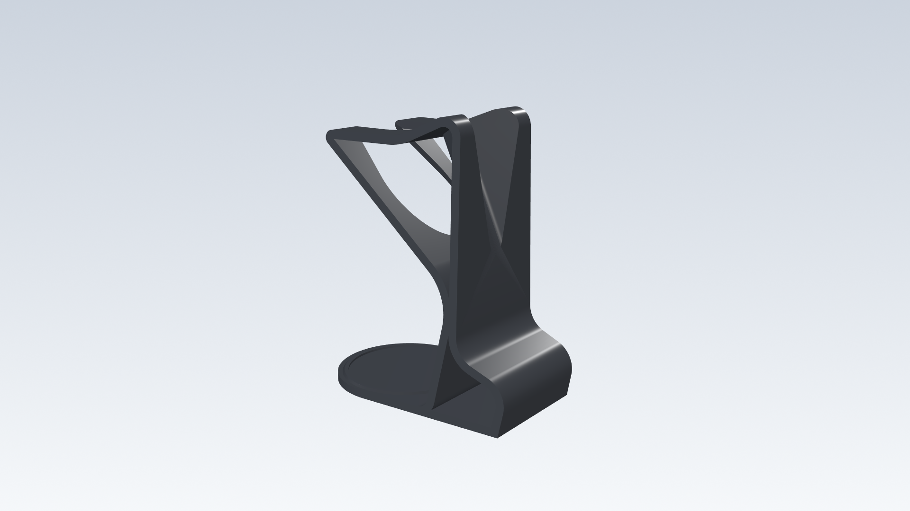
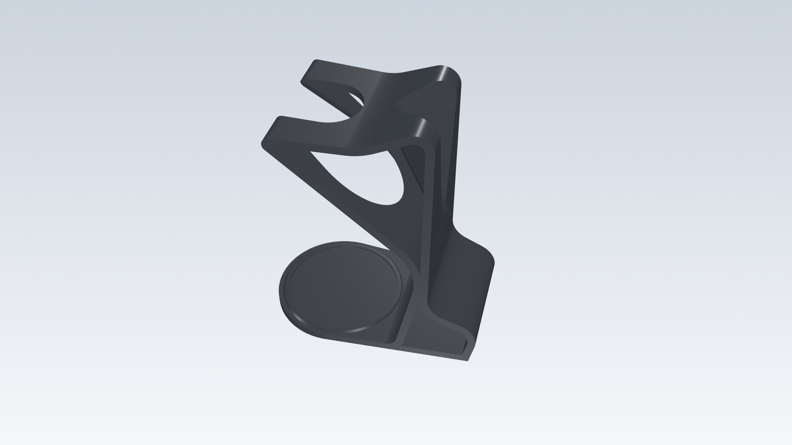
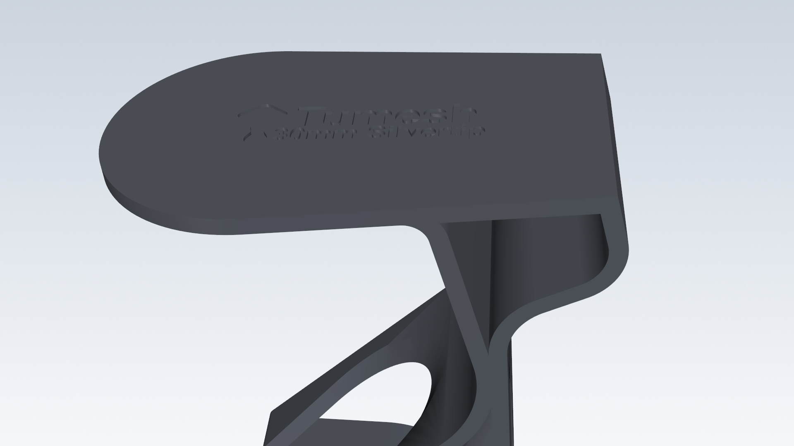
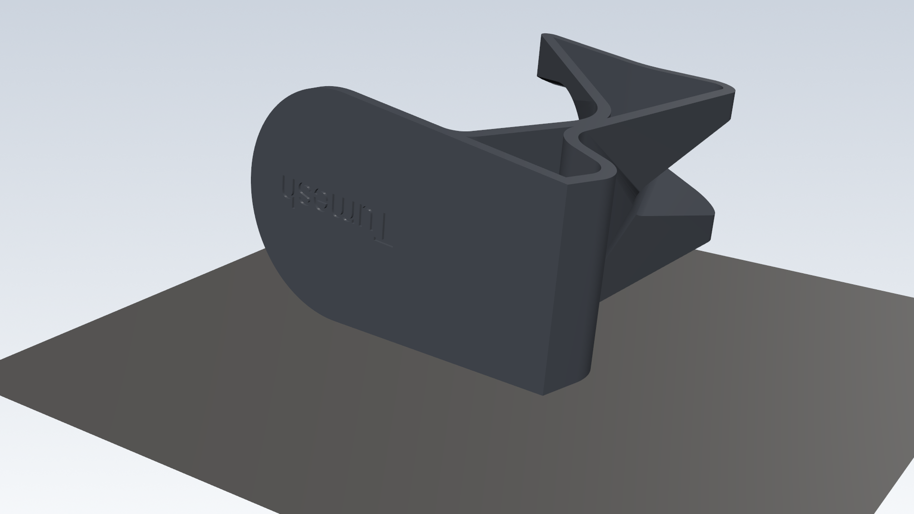
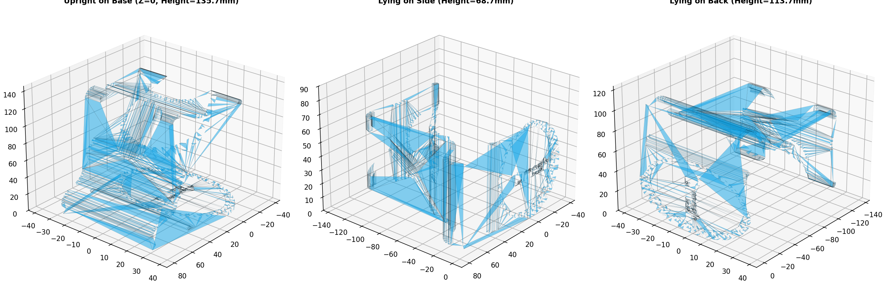
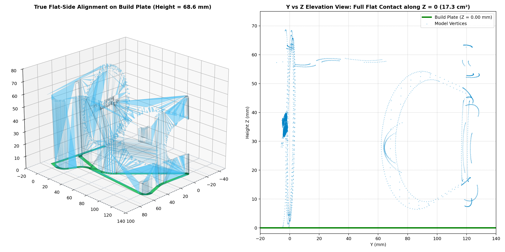
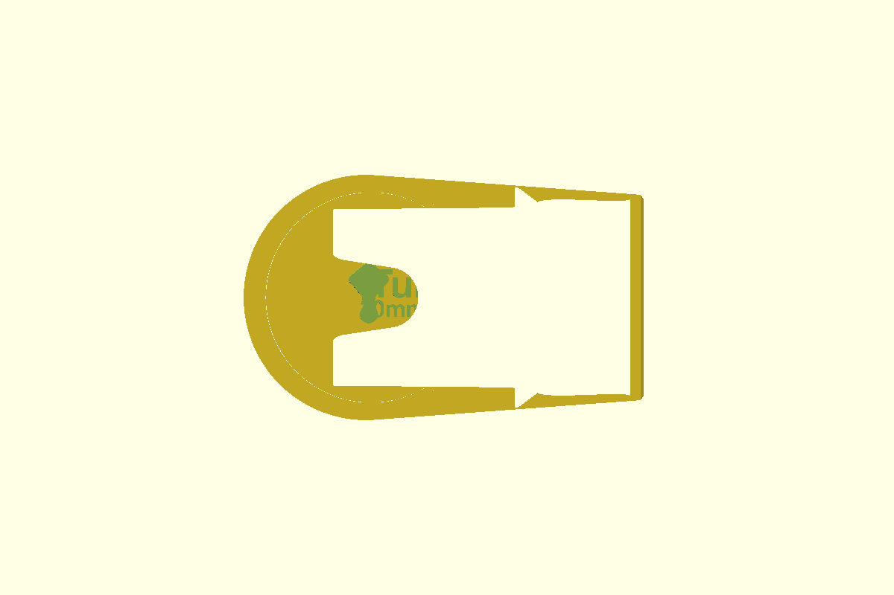
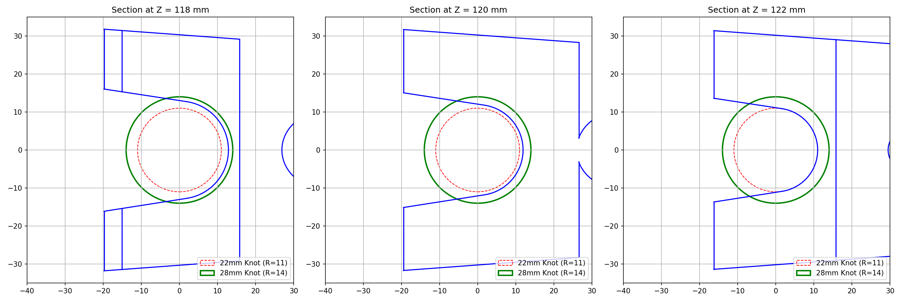

# 🪒 Parametric Safety Razor & Shaving Brush Holder

[](https://tumesh007.github.io/safety-razor-holder-customizer/)
[](https://github.com/tumesh007/safety-razor-holder-customizer/actions/workflows/generate-model.yml)
[](LICENSE)
[](models/)
[](customize_holder.scad)

A high-speed, custom-fit 3D printable holder for traditional safety razors, shaving brushes, soap bowls, and replacement blades.

> **🌐 Live Interactive WebApp**: Customize your brush diameter, name debossing, and emblems with 3D preview in your browser at:  
> **[https://tumesh007.github.io/safety-razor-holder-customizer/](https://tumesh007.github.io/safety-razor-holder-customizer/)**

---

### Key Features:
- **Live 3D Customizer WebApp**: Hosted via GitHub Pages with real-time 3D preview of knot clearances, bottom debossing, and Bambu A1 Mini bed fit.
- **Serverless Cloud STL Compiler (GitHub Actions)**: Customize and compile watertight STL models in ~30s on Ubuntu runners without installing OpenSCAD locally.
- **Fast-Print Flat-Side Orientation**: Cuts print time from **4h 15m down to 2h 28m (~40% faster)** by mathematically cancelling the subtle 4.2° draft angle.
- **Solid Concentric Perimeters**: Defining knot expansion in CAD ensures the slicer builds 3–4 solid outer wall loops, completely avoiding exposed hollow infill cavities caused by hand filing.
- **Pre-Rendered Models Catalog**: Ready-to-slice STLs and CAD STEP files for standard $24\,\text{mm}$, $28.5\,\text{mm}$, and $30\,\text{mm}$ shaving brushes.
- **Studio Rendering Pipeline**: Built-in FreeCAD & VTK PBR rendering script to generate publication-grade showcase images with zero GPU dependencies.

---

## 🎨 Studio Product Showcase

| Studio Hero View (Upright) | Top Functional Overview |
| :---: | :---: |
|  |  |

| Personalized Bottom Branding (Debossed) | Fast-Print Flat-Side Bed Adhesion (PEI Plate) |
| :---: | :---: |
|  |  |

---

## ⚡ How to Customize Your Model

### Option 1: Live Web App (No Installation)
Visit **[https://tumesh007.github.io/safety-razor-holder-customizer/](https://tumesh007.github.io/safety-razor-holder-customizer/)**:
1. Drag the knot diameter slider ($22.0 - 34.0\,\text{mm}$) to match your brush.
2. Enter your name and brush model for debossed engraving on the bottom plate.
3. Select an emblem (Brush, Razor, Crown, Star).
4. Click **"Generate STL via GitHub Actions"** or **"Export .SCAD"**.

### Option 2: Cloud Generation via GitHub Actions
Compile directly on GitHub's cloud runners:
1. Navigate to the **[Actions Tab → Customize & Generate 3D Model](https://github.com/tumesh007/safety-razor-holder-customizer/actions/workflows/generate-model.yml)**.
2. Click **Run workflow**.
3. Choose your Knot Diameter, Owner Name, Brush Model, and Emblem.
4. Click **Run workflow**. In ~30 seconds, download your custom STL from the workflow run artifacts!

### Option 3: Local OpenSCAD GUI or CLI
Open `customize_holder.scad` in [OpenSCAD](https://openscad.org/) or run:
```bash
python scripts/generate_custom.py --knot 28.5 --line1 "TUMESH" --line2 "30mm Silvertip" --logo "Brush"
```

---

## 📸 Technical Analyses & Diagrams

| Fast-Print Flat Orientation (2h 28m) | Draft-Angle Bed Alignment (17.3 cm² Contact) |
| :---: | :---: |
|  |  |

| OpenSCAD Customizer UI | Parametric Knot Cross-Sections |
| :---: | :---: |
|  |  |

---

## ⚡ Why This Redesign?

### 1. The 4.2° Draft Angle Problem Solved
In the original model, the side wall has a subtle $4.2^\circ$ aesthetic taper (normal vector `[0.074, 0.997, 0.033]`). If you simply lay the holder on its side using a standard 90° rotation in your slicer, **only a single sharp corner touches the build plate**, leaving the rest of the model hovering in mid-air.

This project incorporates the exact compensatory affine transformation matrix:
```
R = [
  [ 0.994385, -0.075946,  0.073695,  0.000000 ],
  [-0.075946, -0.027196,  0.996741,  0.000000 ],
  [-0.073695, -0.996741, -0.032811, 34.229908 ],
  [ 0.000000,  0.000000,  0.000000,  1.000000 ]
]
```
This forces the entire side flank into a **100% planar contact ($17.32\,\text{cm}^2$ bed adhesion at $Z = 0.00\,\text{mm}$)**, eliminating bed-lifting warping and reducing print time from **4.2 hours to 2.5 hours**.

### 2. Solid Walls vs. Hand-Filing Cavities
Commercial shaving brushes vary widely in knot diameter:
- Small / Travel knots: $20 - 22\,\text{mm}$
- Standard knots: $24 - 26\,\text{mm}$
- Oversized / Dense badger knots: $28 - 30\,\text{mm}$

If you attempt to file down an undersized print by hand, the outer wall perimeters are worn through, immediately exposing the hollow grid/gyroid infill. By setting the diameter parametrically in CAD, your slicer constructs **3 to 4 continuous solid concentric perimeters** around the opening, providing a smooth, watertight, and hygienic finish.

---

## 📦 Pre-Rendered Models Catalog

Production-ready models are available in both **STL** (3D printing) and **STEP** (CAD engineering) in the [`models/`](models/) directory:

| Knot Diameter | Brush Clearance | Recommended Brushes | Fast-Print (Flat-Side) | Upright Standard |
| :---: | :---: | :---: | :---: | :---: |
| **24.0 mm** | Up to $22.5\,\text{mm}$ | Omega 10065, Semogue 1438, Simpson Classic 1, 20-22mm knots | [`models/24mm/`](models/24mm/) | [`models/24mm/`](models/24mm/) |
| **28.0 mm** | Up to $26.5\,\text{mm}$ | Original geometry base models | [`models/28mm/`](models/28mm/) | [`models/28mm/`](models/28mm/) |
| **28.5 mm** | Up to $27.0\,\text{mm}$ | Simpson Duke 3, Muhle Silvertip 25mm, Yaqi 26mm synthetics | [`models/28.5mm/`](models/28.5mm/) | [`models/28.5mm/`](models/28.5mm/) |
| **30.0 mm** | Up to $28.5\,\text{mm}$ | Simpson Chubby 2/3, Stirling 28mm Kong, Zenith Pro badger knots | [`models/30mm/`](models/30mm/) | [`models/30mm/`](models/30mm/) |

---

## 🖨️ Recommended Slicer Settings

| Parameter | Bambu Studio / OrcaSlicer | PrusaSlicer / SuperSlicer |
| :--- | :--- | :--- |
| **Print Orientation** | **Flat-Side** (Fast 2.5h) | **Flat-Side** (Fast 2.5h) |
| **Support Type** | **Tree (auto)** / Tree Slim | **Organic** |
| **Support Placement** | Support on build plate only | For support enforcers only / Build plate |
| **Overhang Threshold** | 35° – 40° | 35° – 40° |
| **Wall Loops** | **3 to 4 walls** (1.2 - 1.6 mm) | **3 to 4 perimeters** |
| **Top / Bottom Shells** | 4 Top / 4 Bottom | 4 Top / 4 Bottom |
| **Infill Density** | 15% – 20% | 15% – 20% |
| **Infill Pattern** | Gyroid or Cross Hatch | Gyroid |
| **Layer Height** | 0.20 mm (0.16 mm for high-detail text) | 0.20 mm |
| **Recommended Material**| **PETG** (moisture and soap resistant) | **PETG** or **PLA+** |

> **Tree Support Tip**: When slicing in Flat-Side orientation, tree supports will sprout exclusively to support the razor prong overhangs and the curved interior rim. They pop off cleanly with minimal post-processing.

---

## 📸 Re-Generating Studio Renders (FreeCAD + VTK)

To re-render the studio images at 1080p with physically based PBR lighting:

```bash
& "C:\Program Files\FreeCAD 1.1\bin\python.exe" scripts/render_studio_freecad.py
```

This headless pipeline runs completely CPU/OpenGL offscreen, ensuring 100% reliable output on any workstation without GPU dependency.

---

## 💻 Automated Batch Generation (Python)

If you have multiple brushes or want to batch-export a catalog of models:

```bash
python batch_generate_holders.py
```

This script invokes OpenSCAD in headless CLI mode (`openscad.com -o output.stl -D ...`) and builds custom variations in parallel.

---

## 📄 Documentation

For full geometric analyses, contact area verification calculations, and overhang maps, see the Word document in [`docs/Safety_Razor_Holder_Documentation.docx`](docs/Safety_Razor_Holder_Documentation.docx).

---

## 📜 Attribution & License

- **Original Design**: Based on *"Safety razor holder + soap, brush and blades"* by **ConstruKt 3D** ([Thingiverse: thing:2860456](https://www.thingiverse.com/thing:2860456)).
- **Parametric OpenSCAD System, Draft Angle Alignment & Batch Tools**: Created by [tumesh007](https://github.com/tumesh007).
- **License**: Released under the [Creative Commons Attribution-NonCommercial-ShareAlike 4.0 International (CC BY-NC-SA 4.0)](LICENSE) license.
